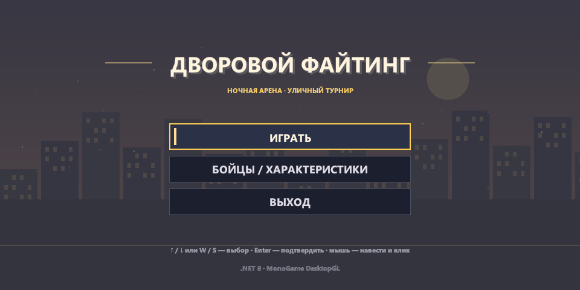
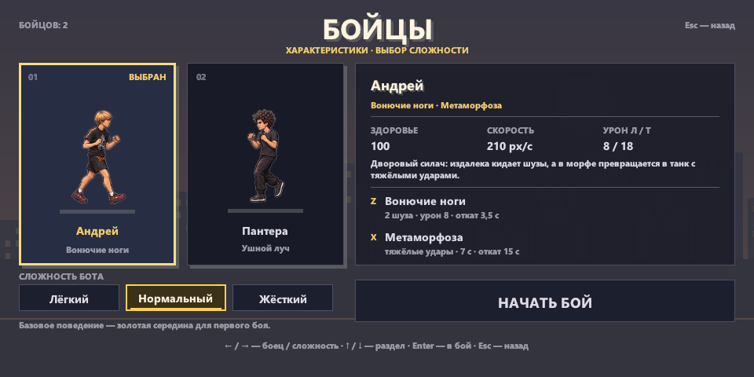
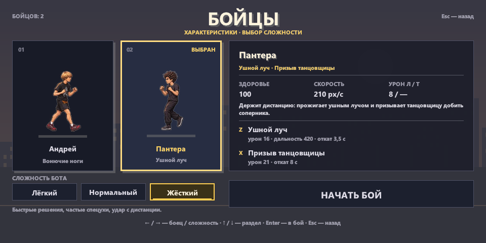

# Дворовой файтинг — C# / MonoGame

Полная переработка исходной одностраничной HTML-игры (`Dvor_Fight (2).html`) на C#
с чистой объектно-ориентированной архитектурой и MonoGame (`DesktopGL`) на .NET 8.

Оригинал был одним файлом на 2,9 МБ с минифицированным JavaScript. Здесь — обычный
C#-проект: слои, классы, наследование, интерфейсы, никакой «магии» в одной строке.

> **Рабочее правило проекта:** в начале любой задачи сначала прочитать этот README и
> структуру проекта, а в конце — обновить README под актуальное состояние (новые экраны,
> классы, управление, флаги запуска, вывод самотеста).

---

## Что реализовано

- **Многоэкранное меню:** титульный экран, экран выбора бойца и характеристик,
  выбор сложности бота, экран результата боя.
- **Два бойца:** Андрей (`ShoesThrow`, `Metamorphosis`) и Пантера (`EarBeam`, `Summon`).
- **Бой:** шаг, прыжок, присед, удары (джеб/кик), тяжёлые удары в форме, разведение тел,
  гравитация, отбрасывание.
- **Спецухи `Z`/`X`:** ботинки, ушной луч, призыв танцовщицы, превращение с cutscene.
- **AI-бот с тремя сложностями:** таймер решений, сближение, атаки, спецухи; умеет
  приседать под луч (в оригинале не умел — фикс из ревью). Лёгкий / Нормальный / Жёсткий
  меняют темп решений, частоту спецух, прыжки и дистанцию удара.
- **Эффекты:** hit-stop, тряска экрана, искры, вспышка при попадании, HP-бары, HUD кулдаунов.
- **Процедурный звук:** осцилляторы (синус/треугольник/пила) + шум с частотным свипом и
  огибающей. Ни одного аудиофайла — как и в оригинале на WebAudio.
- **Кат-сцена метаморфозы:** исходный MP4 раскадрован в 60 PNG и проигрывается в игре.
- **Результат боя:** победитель, связка «боец против бота», сложность, реванш / выбор бойца.

## Экраны меню

Поток экранов: **Title → FighterSelect → Fight → (Result overlay) → FighterSelect → (Esc) Title**.
Из боя по `Esc` тоже можно вернуться к выбору бойца, не дожидаясь KO.

### Титульный экран (`TitleScreen`)

Название «ДВОРОВОЙ ФАЙТИНГ» на затемнённой ночной арене, летящие искры-угольки и три кнопки:

- **Играть** — открывает выбор бойца с фокусом на кнопке «Начать бой»;
- **Бойцы / Характеристики** — открывает выбор бойца с фокусом на карточках и статах;
- **Выход** — завершает игру.

Навигация полностью дублируется клавиатурой (`↑`/`↓`, `W`/`S`, `Enter`) и мышью
(наведение подсвечивает, клик активирует).



### Экран выбора бойца и характеристик (`FighterSelectScreen`)

- **Карточки бойцов** (Андрей, Пантера) с **живой анимацией стойки** прямо из
  `AssetStore` (`andrey/walk`, `pantera/walk`): кадры циклически проигрываются, боец
  слегка «дышит» на карточке.
- **Задел под будущих персонажей:** карточки строятся из `FighterCatalog.All`.
  Нужно добавить класс-наследник `Fighter`, кейс в `FighterFactory` и одну запись в
  каталог — экран сам покажет новую карточку. При росписи больше двух бойцов список
  листается стрелками (видно две карточки за раз, в шапке отображается позиция).
- **Панель характеристик выбранного бойца:** HP, скорость, урон лёгкой/тяжёлой атаки,
  описание, откаты спецух `Z` и `X`. Все числа форматируются **напрямую из
  `Config/Balance.cs`** (`MaxHp`, `WalkSpeed`, `LightDamage`, `HeavyDamage`,
  `ShoeCount`, `SpecialZCooldown`, `MorphXCooldown`, `SummonXCooldown` и т.д.) — в меню
  нет ни одной продублированной цифры баланса.
- **Выбор сложности бота** (Лёгкий / Нормальный / Жёсткий) и кнопка **«Начать бой»**.
  `Enter` запускает бой с выбранными бойцом и сложностью; `Esc` возвращает на титул.
  Мышью: наведение на карточку/сложность сразу выбирает её (чтобы видеть статы),
  клик по «Начать бой» запускает бой.





### Сложности бота (`BotDifficulty`)

Каждая сложность — профиль `BotDifficultyProfile` с множителями к базовым числам AI из
`Balance`. Подписи и описания для меню/HUD лежат отдельно, в `Rendering/DifficultyCatalog`,
чтобы AI-слой не хранил UI-строки. Базовая логика бота одинаковая, меняется только темп
и агрессия:

| Сложность | Темп решений | Частота спецух | Прыжки | Дистанция удара | Характер |
|---|---|---|---|---|---|
| Лёгкий | ×1,60 (реже) | ×0,50 | ×0,50 | ×0,80 | медленный, атакует вблизи |
| Нормальный | ×1,00 | ×1,00 | ×1,00 | ×1,00 | эталонное поведение оригинала |
| Жёсткий | ×0,60 (чаще) | ×1,35 | ×1,30 | ×1,15 | быстрый и агрессивный |

Выбранная сложность передаётся в `FightSession.Start(kind, difficulty)`, сохраняется на
реванш и отображается в HUD (`Пантера · БОТ · НОРМАЛЬНЫЙ`) и на экране результата.

## Что исправлено по сравнению с оригиналом (см. код-ревью)

| Проблема оригинала | Решение здесь |
|---|---|
| Бот запускал кат-сцену превращения и замораживал игру | cutscene запускается только игроком; бот превращается мгновенно |
| Софтлок, если видео не запустилось | кат-сцена — таймер + кадры, софтлок невозможен; есть фолбэк на вспышку |
| Бот не умел приседать → луч неотразим | `BotController` приседает при замахе луча; луч ограничен дистанцией |
| ~151 `fillRect` на кадр (фон каждый кадр) | статичный фон запекается в одну текстуру один раз |
| Магические числа по всему коду | все числа в `Config/Balance.cs` |

## Требования

- **.NET 8 SDK** (в этой среде установлен в `%LOCALAPPDATA%\Microsoft\dotnet`).
- Windows x64 (MonoGame DesktopGL, OpenGL).

Если `dotnet` не в PATH, используйте `build.cmd` / `run.cmd` — они выставляют `DOTNET_ROOT` сами.

## Сборка и запуск

```cmd
build.cmd                :: сборка Release
run.cmd                  :: запуск игры
run.cmd --selftest       :: headless-самотест геймплея, меню и сложностей (без окна)
```

Или вручную:

```powershell
$env:DOTNET_ROOT = "$env:LOCALAPPDATA\Microsoft\dotnet"
& "$env:DOTNET_ROOT\dotnet.exe" build DvorFight.csproj -c Release
& ".\bin\Release\net8.0\DvorFight.exe"
```

### Скриншоты и dev-флаги

Игра умеет отрисовать несколько кадров, сохранить PNG и выйти — удобно для проверки вёрстки
меню и шрифтов:

```powershell
$dotnet = "$env:LOCALAPPDATA\Microsoft\dotnet\dotnet.exe"
$dll = ".\bin\Release\net8.0\DvorFight.dll"
& $dotnet $dll --screenshot screenshots\menu-title.png --screen title
& $dotnet $dll --screenshot screenshots\menu-fighters.png --screen fighters
& $dotnet $dll --screenshot screenshots\menu-fighters-pantera-hard.png --screen fighters --fighter pantera --difficulty hard
& $dotnet $dll --screenshot screenshots\fight-hud.png --screen fight
```

Флаги: `--screen title|fighters|fight` (алиас `fighters` — `select`), `--fighter andrey|pantera`,
`--difficulty easy|normal|hard`, `--fight` (старый алиас `--screen fight`).
Если задан `--screen`, он имеет приоритет над `--fight`.

## Управление

### Меню

| Действие | Клавиши / мышь |
|---|---|
| Титул: выбор пункта | `↑`/`↓` или `W`/`S`, наведение мышью |
| Титул / выбор бойца: подтвердить | `Enter` или клик |
| Выбор бойца: сменить бойца | `←`/`→` или `A`/`D` (фокус на карточках), `1`/`2` |
| Выбор бойца: сменить сложность | `←`/`→`, когда фокус на строке сложности; клик по кнопке |
| Выбор бойца: перейти между разделами | `↑`/`↓` или `W`/`S` |
| Выбор бойца: начать бой | `Enter` или клик по «Начать бой» |
| Назад на титул | `Esc` (с экрана выбора бойца) |

### Бой

| Действие | Клавиши |
|---|---|
| Шаг | `A`/`D` или `←`/`→` |
| Прыжок | `W` / `↑` / `Space` |
| Присед | `S` / `↓` |
| Удар | ЛКМ |
| Спецуха Z | `Z` |
| Спецуха X | `X` |
| Реванш / назад | `R` / `Esc` (с экрана результата: `R`/`Enter`/клик — реванш, `Esc` — выбор бойца) |

## Архитектура (ООП)

```
DvorFight/
├── Program.cs              точка входа (+ --selftest, --screenshot/--screen/--fighter/--difficulty)
├── Game1.cs                MonoGame-оболочка: окно, цикл, переходы меню/бой
├── Core/
│   ├── Entity.cs           абстрактная база: X, Y, Draw()
│   └── Enums.cs            FighterKind, Face, MoveType, SoundType, Command,
│                           GameScreen (Title/FighterSelect/Fight), BotDifficulty
├── Config/
│   └── Balance.cs          ВСЕ игровые числа (баланс, AI, множители сложностей)
├── Domain/
│   ├── Fighter.cs          база бойца: физика, кулдауны, state-машина атаки, спрайты
│   ├── Andrey.cs           : Fighter — ноги + метаморфоза
│   ├── Pantera.cs          : Fighter — луч + призыв
│   ├── Projectile.cs       абстрактный снаряд
│   ├── Shoe.cs             : Projectile
│   ├── Dancer.cs           : Projectile — танцовщица по дуге
│   ├── FighterFactory.cs   единая точка создания бойцов (игрок/бот)
│   └── Spark.cs            эффект искр
├── Combat/
│   └── FightSession.cs     бой: бойцы, снаряды, hit-stop, тряска, cutscene, KO, сложность
├── AI/
│   ├── BotController.cs    поведение бота (применяет профиль сложности)
│   └── BotDifficultyProfile.cs  множители Лёгкий/Нормальный/Жёсткий (без UI-строк)
├── Input/
│   └── InputController.cs  клавиатура/мышь → held + edge-команды (бой)
├── Audio/
│   ├── IAudioEngine.cs     интерфейс (DIP)
│   ├── AudioEngine.cs      процедурная генерация звука
│   └── NullAudioEngine.cs  заглушка для тестов
├── Rendering/
│   ├── AssetStore.cs       загрузка PNG-анимаций в рантайме
│   ├── SpriteAnimation.cs  кадры анимации
│   ├── Renderer.cs         блит спрайтов, прямоугольники, линии
│   ├── Background.cs       запечённый фон (один draw вместо сотен)
│   ├── MorphCutscene.cs    кат-сцена превращения
│   ├── Hud.cs              HP-бары, имена, сложность бота, кулдауны
│   ├── UI.cs               текст с выравниванием
│   ├── ScreenScaler.cs     letterbox-масштабирование 960×480 под окно
│   ├── FontSet.cs          четыре размера шрифта для меню/HUD/результата
│   ├── MenuTheme.cs        общая палитра меню
│   ├── MenuInput.cs        снимок ввода меню (edge-клавиши + виртуальная мышь)
│   ├── MenuCommand.cs      результат апдейта экрана (Play/OpenFighters/StartFight/...)
│   ├── MenuScreen.cs       абстрактный экран меню: навигация, кнопки, перенос текста
│   ├── MenuState.cs        выбранный боец/сложность, общий для экранов
│   ├── TitleScreen.cs      титульный экран: логотип, кнопки, ночная арена, искры
│   ├── FighterSelectScreen.cs  карточки с анимацией, статы, сложность, старт боя
│   ├── FighterCatalog.cs   data-driven каталог бойцов для меню
│   ├── DifficultyCatalog.cs  подписи/описания сложностей для меню, HUD и результата
│   └── ResultOverlay.cs    панель результата боя (победа/поражение, реванш)
└── Diagnostics/
    └── SelfTest.cs         headless-проверка геймплея, меню и сложностей
```

**Принципы:**
- геймплейная логика (`Domain`, `Combat`, `AI`, `Config`) отделена от экранов: рендер
  спрайтов вынесен в `Draw(..., SpriteBatch, Renderer)`, а ввод боя — в `InputController`;
  меню полностью живут в `Rendering/` и не лезут в доменную логику;
- наследование и полиморфизм: `Entity` → `Fighter` → `Andrey`/`Pantera`,
  `Entity` → `Projectile` → `Shoe`/`Dancer`, `MenuScreen` → `TitleScreen`/`FighterSelectScreen`;
- абстрактные члены: `Entity.Draw`, `Fighter.SpritesFaceRight`, `Fighter.OnSpecialX`,
  `Projectile.Update`, `MenuScreen.Update/Draw`;
- инверсия зависимостей: `FightSession` работает через `IAudioEngine`;
- экраны меню возвращают `MenuCommand` вместо прямого управления игрой — навигацию можно
  тестировать headless, без графического устройства;
- каталоги бойцов и сложностей — данные, а не `if`-ы по всему UI; бойцы создаются через
  `FighterFactory`, а не тернарниками в `FightSession`;
- никаких `null`-проверок на каждом шагу — состояние инкапсулировано.

## Ассеты

Исходные спрайты были base64-WebP внутри HTML. Скрипты извлечения:

```
tools/extract_assets.py   → Assets/Sprites (84 PNG, 18 анимаций) + Assets/morph.mp4
tools/extract_morph.py    → Assets/MorphFrames (60 PNG кат-сцены, PyAV)
```

Далее ассеты копируются в `DvorFight/Content/Sprites` и `DvorFight/Content/MorphFrames`
и вкомпилируются в выходную папку. Content Pipeline (MGCB) **не используется** —
текстуры грузятся в рантайме через `Texture2D.FromStream`.

Скриншоты меню для документации лежат в `DvorFight/screenshots/` и снимаются dev-флагом
`--screenshot` (см. выше).

## Самотест

`run.cmd --selftest` прогоняет настоящий боевой код без окна и звуковой карты
(2 сценария × 40 секунд симуляции) и проверяет: игрок наносит урон, бот наносит урон
(AI жив), спецуха создаёт снаряд/призыв, метаморфоза срабатывает. Дополнительно
проверяются меню и сложности (26 проверок сейчас; число растёт вместе с каталогом бойцов):
навигация титула мышью и клавиатурой, выбор бойца/сложности, команда старта, порядок
множителей сложностей, наличие анимаций стоек и реальная передача сложности в
`BotController`. Возвращает `RESULT: PASS` и код 0.

Пример вывода (кадры/HP зависят от RNG бота):

```
=== DvorFight headless self-test ===
[Андрей vs бот] frames=392 (6,5 с) playing=False winner=игрок
          playerHp=47 botHp=0 peakProjectiles=2 botDmg=100 playerDmg=53 morphed=True
[Пантера vs бот] frames=672 (11,2 с) playing=False winner=игрок
          playerHp=28 botHp=0 peakProjectiles=3 botDmg=100 playerDmg=72 morphed=False
[Меню и сложности] проверок=26 провалов=0
RESULT: PASS
```
