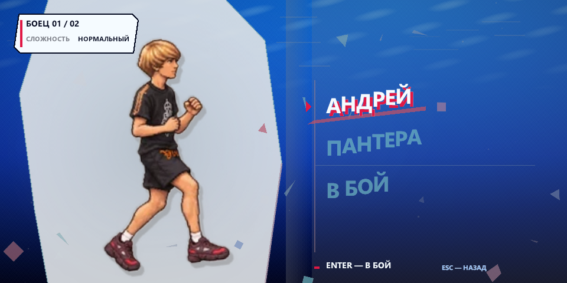

# Дворовой файтинг — C# / MonoGame

Полная переработка исходной одностраничной HTML-игры (`Dvor_Fight (2).html`) на C#
с чистой объектно-ориентированной архитектурой и MonoGame (`DesktopGL`) на .NET 8.

Оригинал был одним файлом на 2,9 МБ с минифицированным JavaScript. Здесь — обычный
C#-проект: слои, классы, наследование, интерфейсы, никакой «магии» в одной строке.

**Текущая версия:** `0.01` — первый публичный билд
([GitHub Release v0.01](https://github.com/andrejbondarev29-source/koch/releases/tag/v0.01)).
Готовый self-contained архив для Windows x64 лежит в релизе; исходная сборка требует .NET 8 SDK.

> **Рабочее правило проекта:** в начале любой задачи сначала прочитать `AGENTS.md`
> (инженерный регламент и карта кода) и этот README, а в конце — обновить README под
> актуальное состояние (новые экраны, классы, управление, флаги запуска, вывод самотеста)
> и, если менялись правила/модули, синхронизировать `AGENTS.md` и `.clinerules`.

---

## Что реализовано

- **Многоэкранное меню:** титульный экран, быстрое меню выбора бойца (портрет + наклонный
  список), подробный экран характеристик, выбор сложности бота, экран результата боя.
- **Два бойца:** Андрей (`ShoesThrow`, `Metamorphosis`) и Пантера (`EarBeam`, `Summon`).
- **Бой:** шаг, прыжок, присед, удары (джеб/кик), тяжёлые удары в форме, разведение тел,
  гравитация, отбрасывание.
- **Спецухи `Z`/`X`:** ботинки, ушной луч, призыв танцовщицы, превращение с cutscene.
- **AI-бот с тремя сложностями:** таймер решений, сближение, атаки, спецухи; умеет
  приседать под луч (в оригинале не умел — фикс из ревью). Лёгкий / Нормальный / Жёсткий
  меняют темп решений, частоту спецух, прыжки и дистанцию удара.
- **Эффекты:** hit-stop, тряска экрана, искры, вспышка при попадании, HP-бары, HUD кулдаунов.
- **Процедурный звук:** осцилляторы (синус/треугольник/пила) + шум с частотным свипом и
  огибающей. Ни одного аудиофайла — как и в оригинале на WebAudio.
- **Кат-сцена метаморфозы:** исходный MP4 раскадрован в 60 PNG и проигрывается в игре.
- **Результат боя:** победитель, связка «боец против бота», сложность, реванш / выбор бойца.

## Экраны меню

Поток экранов:

- **Играть:** `Title → FighterMenu → Fight → (Result overlay) → FighterMenu → (Esc) Title`;
- **Бойцы / Характеристики:** `Title → FighterSelect (статы и сложность) → Fight → (Result overlay) → FighterSelect`.

Из боя по `Esc` тоже можно вернуться к тому экрану выбора, с которого начался бой, не дожидаясь KO.

### Титульный экран (`TitleScreen`)

Название «ДВОРОВОЙ ФАЙТИНГ» на затемнённой ночной арене, летящие искры-угольки и три кнопки:

- **Играть** — открывает быстрое меню выбора бойца (`FighterMenuScreen`) без статов;
- **Бойцы / Характеристики** — открывает подробный экран со статами и сложностью (`FighterSelectScreen`);
- **Выход** — завершает игру.

Навигация полностью дублируется клавиатурой (`↑`/`↓`, `W`/`S`, `Enter`) и мышью
(наведение подсвечивает, клик активирует).


### Быстрый выбор бойца (`FighterMenuScreen`)

Открывается кнопкой **«Играть»**. Минималистичный экран в духе Persona 3 Reload: только
выбор персонажа, без статов, описаний и панелей характеристик.

- **Слева** — крупный портрет на процедурной «бумажной» плашке; та же живая idle-анимация
  и eased-слайд при смене бойца, что и на подробном экране.
- **Справа** — вертикальный наклонный список имён бойцов. Текущая строка — белая с красным
  сдвигом и красной полосой; остальные — циановые.
- **Слева сверху** — белая карточка `БОЕЦ 01 / 02` и текущая сложность (только чтение).
  Сложность меняется на экране «Бойцы / Характеристики» и сохраняется в `MenuState`.
- **Управление:** `↑`/`↓` и `←`/`→` — боец, `Enter` — в бой, `Esc` — назад.
  Мышь: наведение выбирает бойца, **один клик по бойцу сразу запускает бой**; кнопки
  «Начать бой» на экране нет.
- Фон, осколки, пузыри и портрет — те же процедурные `SelectBackdrop`, `ShardField`,
  `PortraitStage`; список и карточка рисуются кодом в `MenuUi`.



> Скриншот (как и два ниже) снят с временным fallback-портретом; после добавления
> оригинальных PNG он будет переснят.

### Экран характеристик (`FighterSelectScreen`)

Открывается кнопкой **«Бойцы / Характеристики»**. Полная версия экрана выбора:

- **Крупный портрет выбранного бойца** на процедурной белой «бумажной» плашке.
  Портрет живёт: медленно «дышит» (вертикальное покачивание, боковое скольжение,
  наклон и лёгкая пульсация масштаба), реагирует на мышь параллаксом. При смене бойца
  играет резкий, но плавный слайд с easing: старый портрет уезжает и гаснет, новый
  выезжает с ускорением и проявляется, из края вылетает короткий сноп осколков.
- **Процедурный фон:** глубокий синий градиент, каустики/блики воды сверху, виньетка,
  летящие геометрические осколки (голубые, синие, розово-красные) и «водяные» пузыри.
  Ни одной фоновой PNG — всё рисует `SelectBackdrop` и `ShardField`.
- **Правая колонка:** крупное имя (64 px), тэглайн, статы, описание, спецухи `Z`/`X`,
  выбор сложности и подсказка «клик по бойцу — в бой». Отдельной кнопки старта нет:
  бой запускается кликом по вкладке бойца или по крупному портрету (а также `Enter`).
  Статы, урон и откаты по-прежнему
  форматируются **напрямую из `Config/Balance.cs`**; строки сложностей — из
  `DifficultyCatalog`.
- **Асимметричные плашки** (параллелограммы со срезанными углами), keycap’ы, диагональные
  акцентные полосы и пульсирующий фокус рисуются кодом в `SelectUi`; PNG-UI не нужен.
- **Анимации и тайминги** вынесены в `SelectMotion` (intro 0,60 с, swap 0,34 с,
  easing-функции), геометрия — в `SelectLayout`, палитра — в `SelectTheme`.
  Логика навигации при этом не блокируется анимацией: `Enter` во время слайда сразу
  запускает бой с уже выбранным бойцом и сложностью.
- **Портреты** — отдельные PNG в `Content/Sprites/portraits/<id>/0.png` (подробности в
  разделе «Ассеты»). Пока файла нет, экран подставляет анимацию стойки, а самотест
  печатает `WARN`, но не падает; после добавления портретов предупреждение исчезает.
- **Задел под будущих персонажей:** вкладки строятся из `FighterCatalog.All`, при >2
  бойцах список листается стрелками (видны две вкладки). Нужно добавить класс-наследник
  `Fighter`, кейс в `FighterFactory`, запись в каталог и портрет — экран сам покажет
  нового бойца.
- **Мышь:** наведение на вкладку сразу выбирает бойца; клик по вкладке бойца или по
  портрету запускает бой; клик по сложности переключает её; `Esc` возвращает на титул.


> Скриншоты в этом коммите сняты с временным fallback-портретом (стойка бойца):
> оригинальные крупные портреты добавляются отдельным коммитом, после чего PNG будут
> пересняты.

### Сложности бота (`BotDifficulty`)

Каждая сложность — профиль `BotDifficultyProfile` с множителями к базовым числам AI из
`Balance`. Подписи и описания для меню/HUD лежат отдельно, в `Rendering/DifficultyCatalog`,
чтобы AI-слой не хранил UI-строки. Базовая логика бота одинаковая, меняется только темп
и агрессия:

| Сложность | Темп решений | Частота спецух | Прыжки | Дистанция удара | Характер |
|---|---|---|---|---|---|
| Лёгкий | ×1,60 (реже) | ×0,50 | ×0,50 | ×0,80 | медленный, атакует вблизи |
| Нормальный | ×1,00 | ×1,00 | ×1,00 | ×1,00 | эталонное поведение оригинала |
| Жёсткий | ×0,60 (чаще) | ×1,35 | ×1,30 | ×1,15 | быстрый и агрессивный |

Выбранная сложность передаётся в `FightSession.Start(kind, difficulty)`, сохраняется на
реванш и отображается в HUD (`Пантера · БОТ · НОРМАЛЬНЫЙ`) и на экране результата.

## Что исправлено по сравнению с оригиналом (см. код-ревью)

| Проблема оригинала | Решение здесь |
|---|---|
| Бот запускал кат-сцену превращения и замораживал игру | cutscene запускается только игроком; бот превращается мгновенно |
| Софтлок, если видео не запустилось | кат-сцена — таймер + кадры, софтлок невозможен; есть фолбэк на вспышку |
| Бот не умел приседать → луч неотразим | `BotController` приседает при замахе луча; луч ограничен дистанцией |
| ~151 `fillRect` на кадр (фон каждый кадр) | статичный фон запекается в одну текстуру один раз |
| Магические числа по всему коду | все числа в `Config/Balance.cs` |

## Требования

- **.NET 8 SDK** (в этой среде установлен в `%LOCALAPPDATA%\Microsoft\dotnet`).
- Windows x64 (MonoGame DesktopGL, OpenGL).

Если `dotnet` не в PATH, используйте `build.cmd` / `run.cmd` — они выставляют `DOTNET_ROOT` сами.

### Готовый релиз 0.01

Для игроков собран self-contained архив `DvorFight-0.01-win-x64.zip` (Windows x64,
.NET-рантайм внутри, SDK не нужен). Скачать: [GitHub Release v0.01](https://github.com/andrejbondarev29-source/koch/releases/tag/v0.01).
Распаковать и запустить `DvorFight.exe`.

## Сборка и запуск

```cmd
build.cmd                :: сборка Release
run.cmd                  :: запуск игры
run.cmd --selftest       :: headless-самотест геймплея, меню и сложностей (без окна)
```

Или вручную:

```powershell
$env:DOTNET_ROOT = "$env:LOCALAPPDATA\Microsoft\dotnet"
& "$env:DOTNET_ROOT\dotnet.exe" build DvorFight.csproj -c Release
& ".\bin\Release\net8.0\DvorFight.exe"
```

### Скриншоты и dev-флаги

Игра умеет отрисовать несколько кадров, сохранить PNG и выйти — удобно для проверки вёрстки
меню и шрифтов:

```powershell
$dotnet = "$env:LOCALAPPDATA\Microsoft\dotnet\dotnet.exe"
$dll = ".\bin\Release\net8.0\DvorFight.dll"
& $dotnet $dll --screenshot screenshots\menu-title.png --screen title
& $dotnet $dll --screenshot screenshots\menu-character-select.png --screen fighters
& $dotnet $dll --screenshot screenshots\menu-fighters.png --screen details
& $dotnet $dll --screenshot screenshots\menu-fighters-pantera-hard.png --screen details --fighter pantera --difficulty hard
& $dotnet $dll --screenshot screenshots\fight-hud.png --screen fight
```

Флаги: `--screen title|fighters|details|fight` (алиасы: `fighters` — `select`/`menu`,
`details` — `stats`), `--fighter andrey|pantera`, `--difficulty easy|normal|hard`,
`--fight` (старый алиас `--screen fight`).
Если задан `--screen`, он имеет приоритет над `--fight`.

## Управление

### Меню

| Действие | Клавиши / мышь |
|---|---|
| Титул: выбор пункта | `↑`/`↓` или `W`/`S`, наведение мышью |
| Титул: подтвердить | `Enter` или клик |
| Быстрый выбор: сменить бойца | `↑`/`↓`, `←`/`→` или `A`/`D`, `1`/`2`, наведение мышью |
| Быстрый выбор: начать бой | `Enter` или клик по бойцу |
| Экран характеристик: выбрать бойца | `←`/`→` или `A`/`D` (фокус на вкладках), `1`/`2`, наведение мышью |
| Экран характеристик: сменить сложность | `←`/`→`, когда фокус на строке сложности; клик по кнопке |
| Экран характеристик: перейти между разделами | `↑`/`↓` или `W`/`S` |
| Экран характеристик: начать бой | `Enter`, клик по вкладке бойца или по крупному портрету |
| Назад на титул | `Esc` (с любого экрана выбора) |

### Бой

| Действие | Клавиши |
|---|---|
| Шаг | `A`/`D` или `←`/`→` |
| Прыжок | `W` / `↑` / `Space` |
| Присед | `S` / `↓` |
| Удар | ЛКМ |
| Спецуха Z | `Z` |
| Спецуха X | `X` |
| Реванш / назад | `R` / `Esc` (с экрана результата: `R`/`Enter`/клик — реванш, `Esc` — выбор бойца) |

## Архитектура (ООП)

```
DvorFight/
├── Program.cs              точка входа (+ --selftest, --screenshot/--screen/--fighter/--difficulty)
├── Game1.cs                MonoGame-оболочка: окно, цикл, переходы меню/бой
├── Core/
│   ├── Entity.cs           абстрактная база: X, Y, Draw()
│   └── Enums.cs            FighterKind, Face, MoveType, SoundType, Command,
│                           GameScreen (Title/FighterSelect/Fight), BotDifficulty
├── Config/
│   └── Balance.cs          ВСЕ игровые числа (баланс, AI, множители сложностей)
├── Domain/
│   ├── Fighter.cs          база бойца: физика, кулдауны, state-машина атаки, спрайты
│   ├── Andrey.cs           : Fighter — ноги + метаморфоза
│   ├── Pantera.cs          : Fighter — луч + призыв
│   ├── Projectile.cs       абстрактный снаряд
│   ├── Shoe.cs             : Projectile
│   ├── Dancer.cs           : Projectile — танцовщица по дуге
│   ├── FighterFactory.cs   единая точка создания бойцов (игрок/бот)
│   └── Spark.cs            эффект искр
├── Combat/
│   └── FightSession.cs     бой: бойцы, снаряды, hit-stop, тряска, cutscene, KO, сложность
├── AI/
│   ├── BotController.cs    поведение бота (применяет профиль сложности)
│   └── BotDifficultyProfile.cs  множители Лёгкий/Нормальный/Жёсткий (без UI-строк)
├── Input/
│   └── InputController.cs  клавиатура/мышь → held + edge-команды (бой)
├── Audio/
│   ├── IAudioEngine.cs     интерфейс (DIP)
│   ├── AudioEngine.cs      процедурная генерация звука
│   └── NullAudioEngine.cs  заглушка для тестов
├── Rendering/
│   ├── AssetStore.cs       загрузка PNG-анимаций в рантайме
│   ├── SpriteAnimation.cs  кадры анимации
│   ├── Renderer.cs         блит спрайтов, прямоугольники, линии
│   ├── Background.cs       запечённый фон (один draw вместо сотен)
│   ├── MorphCutscene.cs    кат-сцена превращения
│   ├── Hud.cs              HP-бары, имена, сложность бота, кулдауны
│   ├── UI.cs               текст с выравниванием
│   ├── ScreenScaler.cs     letterbox-масштабирование 960×480 под окно
│   ├── FontSet.cs          пять размеров шрифта для меню/HUD/результата (вкл. Display 64)
│   ├── MenuTheme.cs        общая палитра меню
│   ├── MenuInput.cs        снимок ввода меню (edge-клавиши + виртуальная мышь)
│   ├── MenuCommand.cs      результат апдейта экрана (Play/OpenFighters/StartFight/...)
│   ├── MenuScreen.cs       абстрактный экран меню: навигация, кнопки, перенос текста
│   ├── MenuState.cs        выбранный боец/сложность, общий для экранов
│   ├── TitleScreen.cs      титульный экран: логотип, кнопки, ночная арена, искры
│   ├── FighterMenuScreen.cs  быстрое меню: портрет + наклонный список, без статов
│   ├── MenuLayout.cs       геометрия быстрого меню (карточка, список, хинты)
│   ├── MenuUi.cs           белая карточка, наклонный список, нижние подсказки
│   ├── MenuClickGuard.cs   подавление клика-сквозь после открытия экрана
│   ├── FighterSelectScreen.cs  подробный экран: портрет, статы, сложность, старт
│   ├── SelectTheme.cs      палитра экрана выбора (синий/циан/розовый)
│   ├── SelectMotion.cs     тайминги и easing-функции intro/swap/idle
│   ├── SelectLayout.cs     все прямоугольники и хитбоксы экрана выбора
│   ├── SelectBackdrop.cs   процедурный синий фон, каустики, блики, пузыри
│   ├── ShardField.cs       летящие геометрические осколки (детерминированные)
│   ├── PortraitStage.cs    бумажная плашка, свечение, тень и отрисовка портрета
│   ├── SelectUi.cs         асимметричные плашки, keycap’ы, имя, кнопка старта
│   ├── FighterCatalog.cs   data-driven каталог бойцов и ключей портретов
│   ├── DifficultyCatalog.cs  подписи/описания сложностей для меню, HUD и результата
│   └── ResultOverlay.cs    панель результата боя (победа/поражение, реванш)
└── Diagnostics/
    └── SelfTest.cs         headless-проверка геймплея, меню и сложностей
```

**Принципы:**
- геймплейная логика (`Domain`, `Combat`, `AI`, `Config`) отделена от экранов: рендер
  спрайтов вынесен в `Draw(..., SpriteBatch, Renderer)`, а ввод боя — в `InputController`;
  меню полностью живут в `Rendering/` и не лезут в доменную логику;
- наследование и полиморфизм: `Entity` → `Fighter` → `Andrey`/`Pantera`,
  `Entity` → `Projectile` → `Shoe`/`Dancer`,
  `MenuScreen` → `TitleScreen`/`FighterMenuScreen`/`FighterSelectScreen`;
- абстрактные члены: `Entity.Draw`, `Fighter.SpritesFaceRight`, `Fighter.OnSpecialX`,
  `Projectile.Update`, `MenuScreen.Update/Draw`;
- инверсия зависимостей: `FightSession` работает через `IAudioEngine`;
- экраны меню возвращают `MenuCommand` вместо прямого управления игрой — навигацию можно
  тестировать headless, без графического устройства;
- каталоги бойцов и сложностей — данные, а не `if`-ы по всему UI; бойцы создаются через
  `FighterFactory`, а не тернарниками в `FightSession`;
- никаких `null`-проверок на каждом шагу — состояние инкапсулировано.

## Ассеты

Исходные спрайты были base64-WebP внутри HTML. Скрипты извлечения:

```
tools/extract_assets.py   → Assets/Sprites (84 PNG, 18 анимаций) + Assets/morph.mp4
tools/extract_morph.py    → Assets/MorphFrames (60 PNG кат-сцены, PyAV)
```

Далее ассеты копируются в `DvorFight/Content/Sprites` и `DvorFight/Content/MorphFrames`
и вкомпилируются в выходную папку. Content Pipeline (MGCB) **не используется** —
текстуры грузятся в рантайме через `Texture2D.FromStream`.

### Портреты экрана выбора

Крупные портреты — обычные PNG-ассеты, которые подхватывает `AssetStore`:

```
Content/Sprites/portraits/andrey/0.png
Content/Sprites/portraits/pantera/0.png
```

- размер: **1200×1600** (минимум 1024×1365), PNG-32, **straight alpha**, фон прозрачный;
- персонаж — поясной/по грудной 3/4-портрет, лицо обращено вправо, с запасом 100 px
  по краям (код наклоняет и качает портрет);
- имя файла строго `0.png` (загрузчик сортирует кадры по числу); папка = ключ анимации;
- белая «бумажная» плашка, свечение, тень и наклон рисуются кодом — в PNG их быть не должно;
- опционально: `Content/Fonts/display.ttf` — геометрический дисплейный шрифт для имени
  (обязательно с кириллицей; при отсутствии используется `segoeuib.ttf` 64 px) и второй
  кадр `1.png` для «моргания».

Пока портрет не добавлен, `PortraitStage` показывает анимацию стойки, а `--selftest`
печатает `WARN` (не ошибку); после добавления файлов предупреждение исчезает.

Скриншоты меню для документации лежат в `DvorFight/screenshots/` и снимаются dev-флагом
`--screenshot` (см. выше).

## Самотест

`run.cmd --selftest` прогоняет настоящий боевой код без окна и звуковой карты
(2 сценария × 40 секунд симуляции) и проверяет: игрок наносит урон, бот наносит урон
(AI жив), спецуха создаёт снаряд/призыв, метаморфоза срабатывает. Дополнительно
проверяются меню и сложности (61 проверка сейчас; число растёт вместе с каталогом бойцов):
навигация титула мышью и клавиатурой, быстрый выбор бойца, выбор бойца/сложности на
подробном экране, команда старта, порядок множителей сложностей, наличие анимаций стоек,
реальная передача сложности в `BotController`, а также **анимации обоих экранов выбора**:
запуск и завершение intro, старт/завершение слайда при смене бойца, монотонное затухание
смещения портрета, старт боя во время слайда, перенацеливание при повторном переключении,
запрет старта по клику на заголовок/инфо-карточку/пустое место, независимость сложности
от наведения мыши и подавление клика-сквозь после открытия экрана.
Возвращает `RESULT: PASS` и код 0.

Пример вывода (кадры/HP зависят от RNG бота):

```
=== DvorFight headless self-test ===
[Андрей vs бот] frames=470 (7,8 с) playing=False winner=игрок
          playerHp=76 botHp=0 peakProjectiles=3 botDmg=100 playerDmg=24 morphed=True
[Пантера vs бот] frames=690 (11,5 с) playing=False winner=игрок
          playerHp=4 botHp=0 peakProjectiles=1 botDmg=100 playerDmg=96 morphed=False
          WARN: портрет ещё не добавлен: portraits/andrey/0.png
          WARN: портрет ещё не добавлен: portraits/pantera/0.png
[Меню и сложности] проверок=61 провалов=0
RESULT: PASS
```
